<p align="center">
  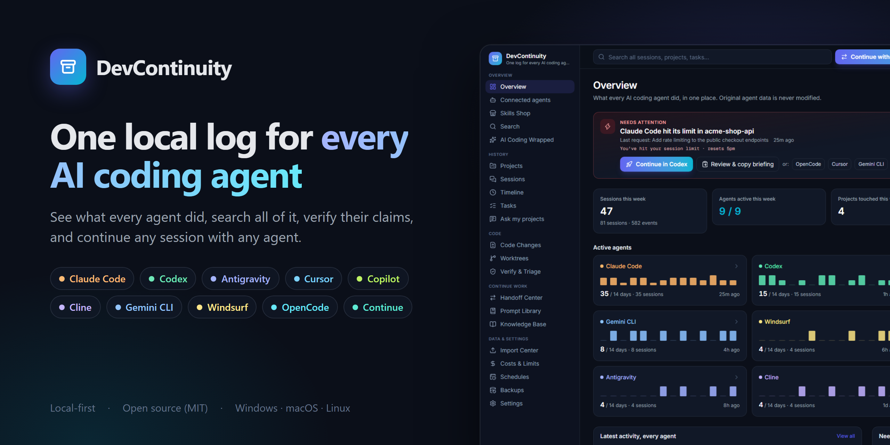
</p>

<p align="center">
  <a href="https://github.com/ahmadrashed1999/devcontinuity/actions/workflows/ci.yml"></a>
  <a href="LICENSE"></a>
  
  
</p>

# DevContinuity

**One local log for every AI coding agent.**

<p align="center">
  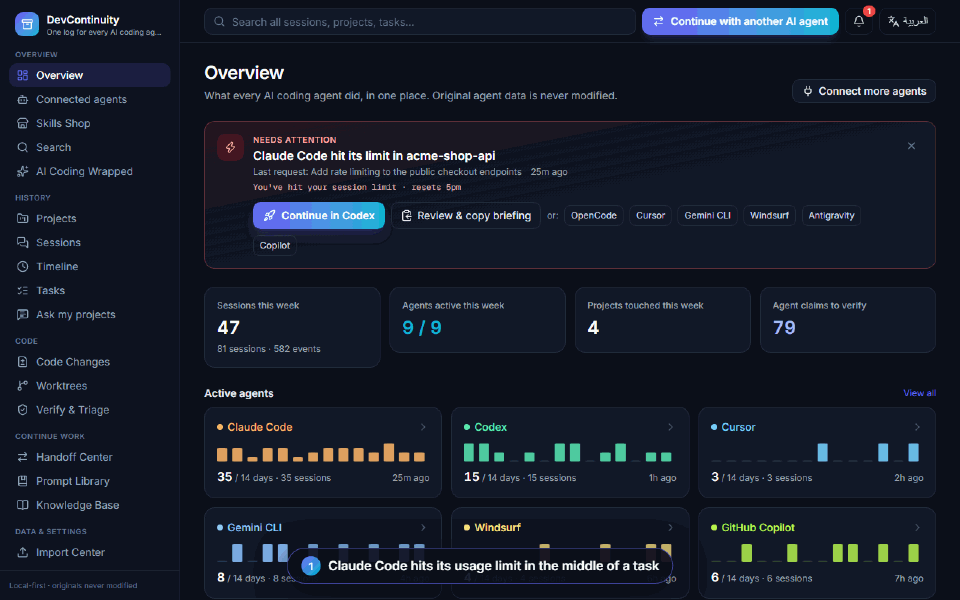
  <br /><sub>Claude Code hits its limit → DevContinuity tells you → review the briefing → Codex continues → its session lands in the same log. (Fictional demo workspace.)</sub>
</p>

You use Claude Code in the morning, Codex after lunch, Antigravity or Cursor for a UI task, and Copilot in VS Code. Each one keeps its history in its own place and format, and none of them knows what the others did. DevContinuity collects all of it into one searchable timeline on your own machine, shows what each agent actually changed, and lets any agent pick up where another one stopped.

- **Every agent, one timeline:** Claude Code, Codex, OpenCode, Antigravity, Cline, Roo Code, Kilo Code, GitHub Copilot Chat, Continue, Gemini CLI, Cursor, Windsurf, Aider, Zed, ChatGPT and Claude.ai exports, Qwen Code, Copilot CLI, Kiro, and anything that can send an HTTP request.
- **Hit a limit? Keep going:** when an agent stops on its usage limit, one click continues the same work in another agent with a reviewed briefing.
- **Your agents finally share memory:** the `project_context` MCP tool tells any agent what the others did in this folder.
- **Local-first:** runs on your computer and keeps your data in one folder. Your agents' original files are only ever read, never modified.
- **Continue anywhere:** a ready-to-paste briefing (last request, last answer, changed files, errors, Git state) lets another agent take over a project or session.
- **Trust, but verify:** agent "I'm done" claims are tracked as claims; DevContinuity checks recorded edits and commits against your actual files and Git.
- **Search everything:** full-text search over every prompt, answer, tool call, command and error, in any language.

## Screenshots

**Overview:** activity per agent over two weeks, the latest sessions from every agent, and what needs your attention.

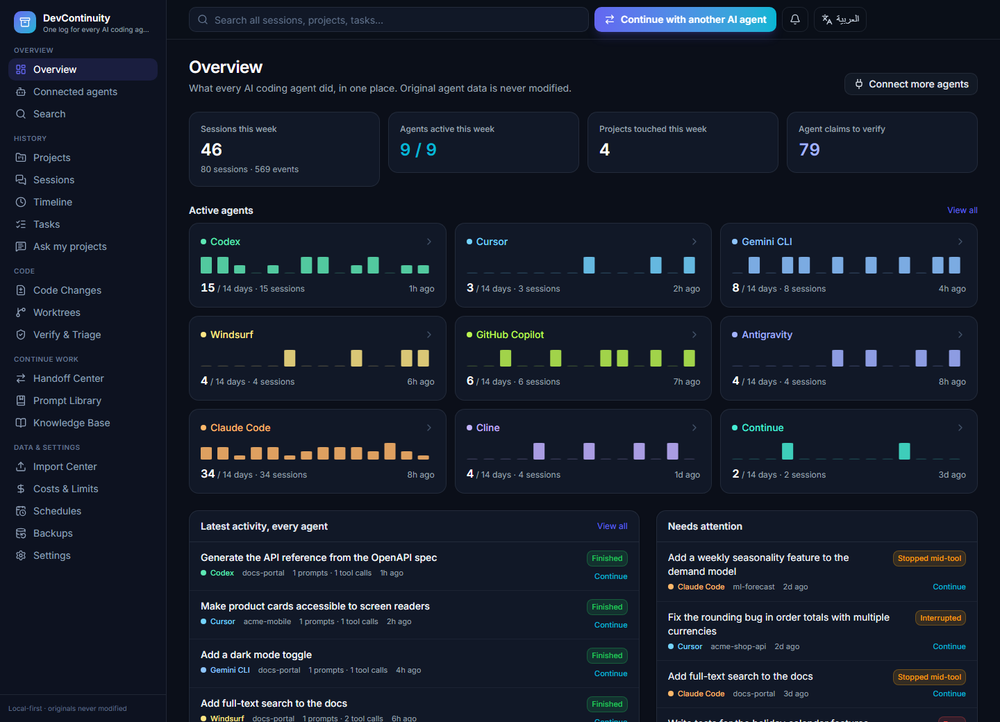

<table>
  <tr>
    <td width="50%">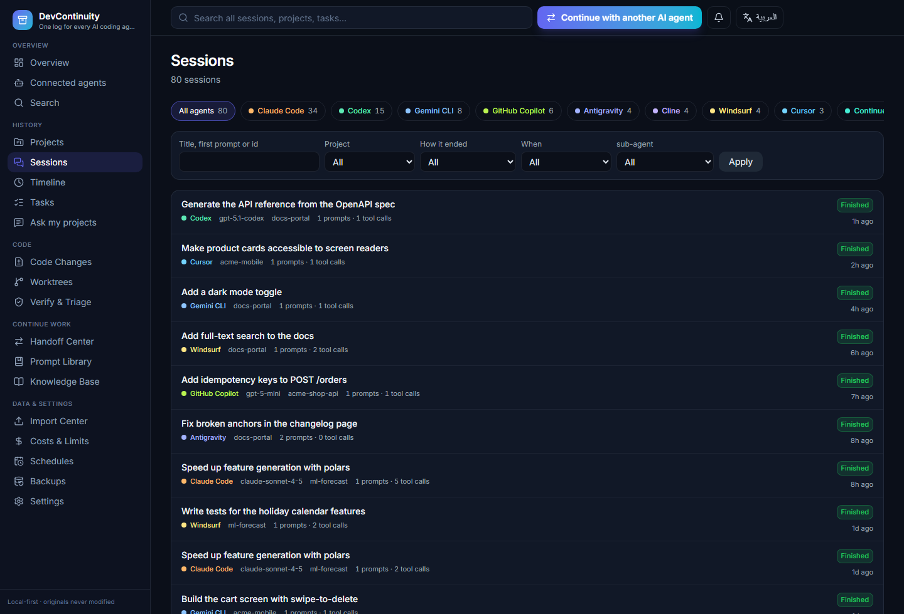<br /><sub><b>Sessions:</b> every agent in one list; one click filters by agent.</sub></td>
    <td width="50%">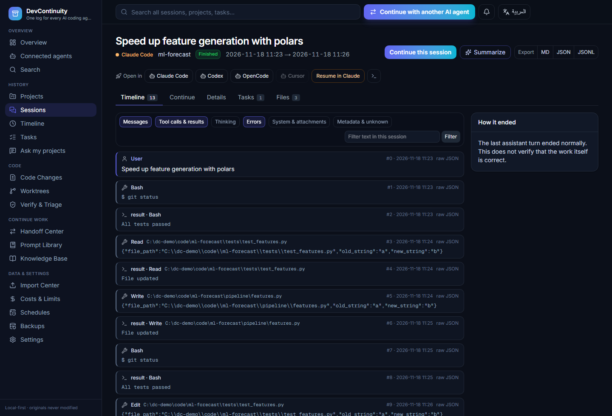<br /><sub><b>Session timeline:</b> prompts, tool calls, output and files, with one-click continue.</sub></td>
  </tr>
  <tr>
    <td width="50%">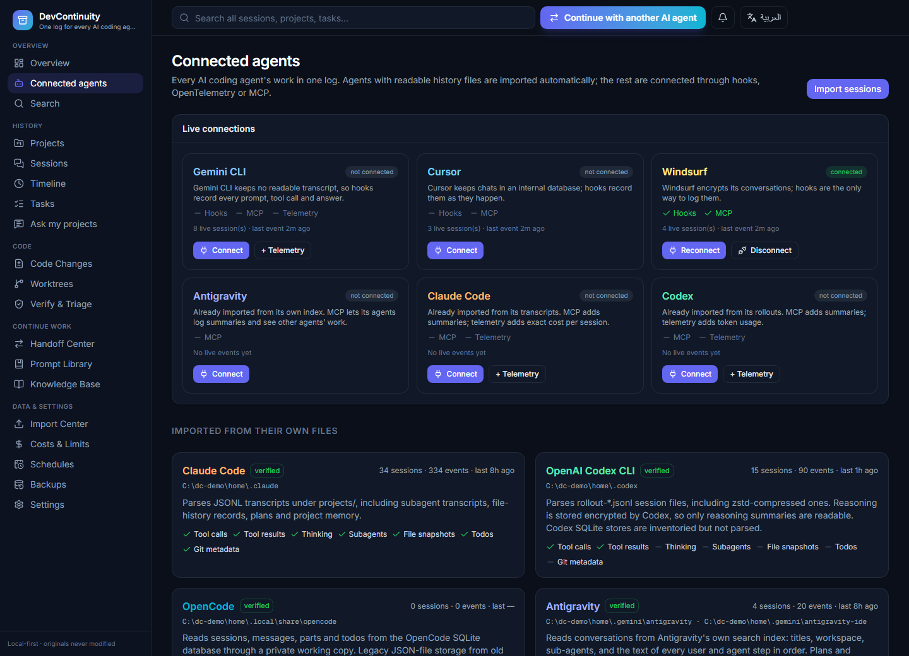<br /><sub><b>Connected agents:</b> connect Gemini CLI, Cursor, Windsurf and more with a previewed, reversible change.</sub></td>
    <td width="50%">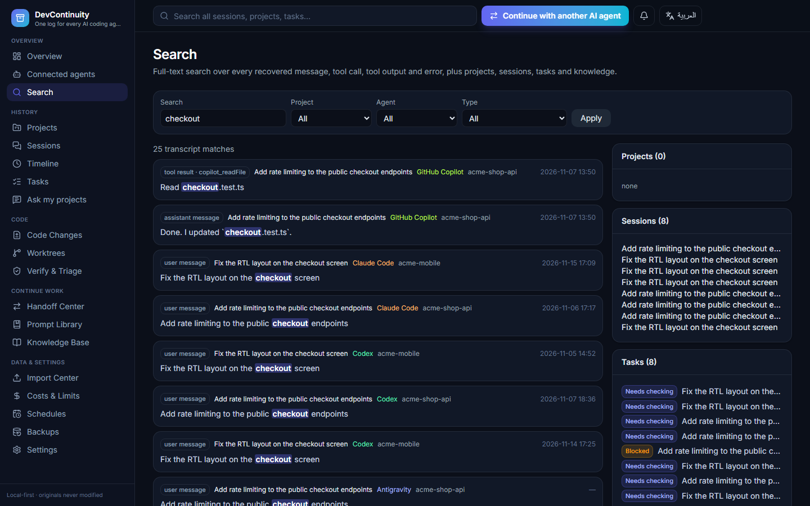<br /><sub><b>Search:</b> any prompt, answer, command or error, across every agent.</sub></td>
  </tr>
  <tr>
    <td width="50%">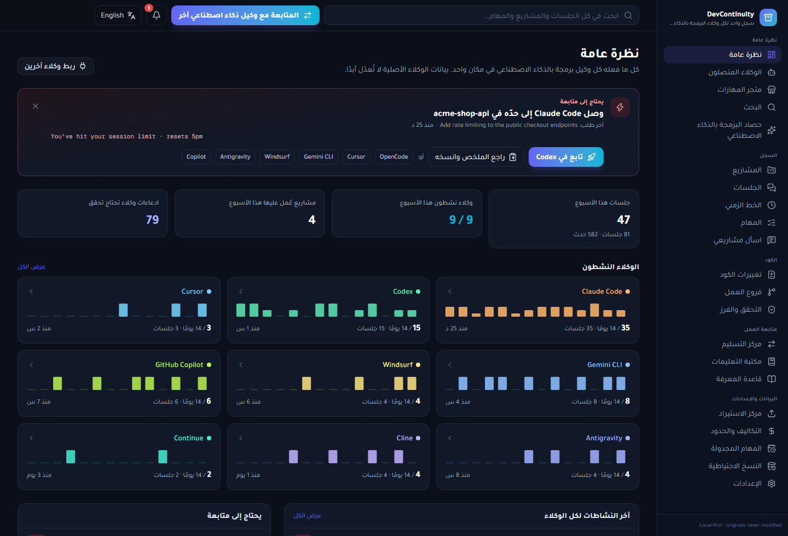<br /><sub><b>English and Arabic</b>, with a full right-to-left layout.</sub></td>
    <td width="50%" align="center">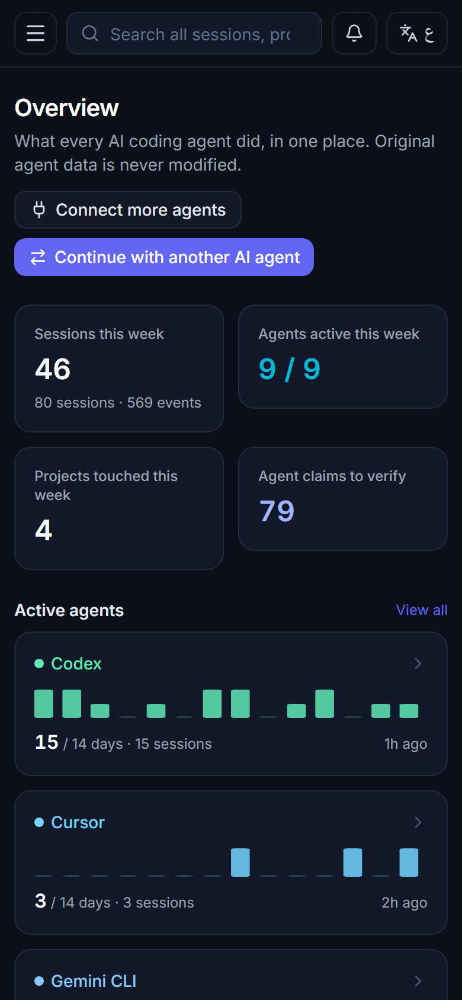<br /><sub><b>Works on phones.</b></sub></td>
  </tr>
</table>

<sub>Screenshots use the fictional demo workspace from <code>npm run demo</code>, not real history.</sub>

> Status: works well day to day on Windows; macOS and Linux run the same web app and background service (the tray icon is Windows-only). See [docs/ARCHITECTURE.md](docs/ARCHITECTURE.md#limitations) for what is and is not covered per agent.

---

## Quick start

You need **Node.js 22.5 or newer**.

```bash
npx devcontinuity
```

That is the whole install: it creates `~/.devcontinuity` (your data, nothing else is written), applies the database migrations, starts the web UI and the background sync, and opens **http://localhost:3210**. Every CLI command works the same way:

```bash
npx devcontinuity connect windsurf   # show the hook/MCP change; add --yes to apply it (a backup is made first)
npx devcontinuity agents             # which agents are connected and what they logged
npx devcontinuity search "rate limit"
npx devcontinuity --port 4000 --no-open
```

Set `DEVCONTINUITY_DATA_DIR` to keep the data somewhere else. `npm install -g devcontinuity` gives you a permanent `devcontinuity` command.

### From source

You need Git as well.

```bash
git clone https://github.com/ahmadrashed1999/devcontinuity.git
cd devcontinuity
npm install
npm run setup     # creates ./data and the database (safe to repeat; never deletes anything)
npm run build
npm run app       # web UI + background sync at http://localhost:3210
```

Open **http://localhost:3210**. The first sync imports every agent it finds on your machine; after that, new sessions appear on their own.

On Windows you can instead run `npm run tray` for a tray icon, and `npm run startup:install` to start it with Windows.

New here? Read the **[usage guide](docs/USAGE.md)**: it walks through the first import, connecting agents, finding things and continuing work.

---

## Supported agents

| Agent | How it is captured | Setup |
| --- | --- | --- |
| Claude Code | Transcript files (`~/.claude/projects`), including sub-agents | Automatic |
| OpenAI Codex CLI | Rollout files (`~/.codex/sessions`), including compressed ones | Automatic |
| OpenCode | Its SQLite database | Automatic |
| Google Antigravity | Its conversation index: titles, folders, sub-agents, every message in order, plans | Automatic |
| Cline, Roo Code, Kilo Code | Task files in VS Code, Cursor, Windsurf, Antigravity, Trae… | Automatic |
| GitHub Copilot Chat | VS Code chat sessions, in every VS Code-family editor | Automatic |
| Continue | `~/.continue/sessions` | Automatic |
| Aider | `.aider.chat.history.md` (+ prompt times from `.aider.input.history`) in your project folders | Automatic for known projects; add other folders in Settings |
| Zed *(experimental)* | Text threads (`conversations/*.zed.json`) and agent threads (`threads/threads.db`) | Automatic |
| ChatGPT | Data export (`conversations.json` or the ZIP) | Upload in the **Import Center** |
| Claude.ai | Data export (`conversations.json` or the ZIP) | Upload in the **Import Center** |
| Gemini CLI | Hooks (+ optional OpenTelemetry for token usage) | `npx devcontinuity connect gemini-cli --yes` |
| Cursor | Hooks | `npx devcontinuity connect cursor --yes` |
| Windsurf | Hooks (its own history is encrypted) | `npx devcontinuity connect windsurf --yes` |
| Qwen Code *(experimental)* | Gemini-style hooks, MCP, optional OpenTelemetry | `npx devcontinuity connect qwen-code --yes` |
| Copilot CLI *(experimental)* | MCP + per-repository hooks file (shown when you connect) | `npx devcontinuity connect copilot-cli --yes` |
| Kiro *(experimental)* | MCP + Kiro CLI agent hooks (shown when you connect) | `npx devcontinuity connect kiro --yes` |
| Anything else | HTTP API, OpenTelemetry logs, or the MCP `log_summary` tool | See [Any other tool](#any-other-tool) |

"Connect" is also one click on the **Connected agents** page. It shows exactly which config files it will change, backs up the originals first, and only adds or removes DevContinuity's own entries. `npx devcontinuity disconnect <agent> --yes` undoes it. *Experimental* recipes were built from each tool's published formats and tested with fixtures, not yet on every version; please report what you see.

## When an agent hits its limit

When a session stops on a usage, rate or billing limit (Claude Code's "You've hit your session limit", HTTP 429, quota or credit errors), DevContinuity notifies you and puts a card at the top of the **Overview**: *"Claude Code hit its limit in acme-shop-api — Continue in Codex"*. One click opens the next agent in the project folder with a briefing (last request, files changed, errors, Git state); for agents it cannot open, it copies the briefing. Pick your preferred fallback agent in **Settings → Agents**. Opening agents works on Windows (Windows Terminal/PowerShell), macOS (iTerm or Terminal) and Linux (gnome-terminal, konsole, xterm and others).

Every briefing and handoff package goes through **Review before sharing** first: you see the exact text, with redacted secrets, secret-looking strings, e-mail addresses and home-folder paths highlighted, and you can leave out any section (or whole files of a package) before it is copied or exported.

## How it works

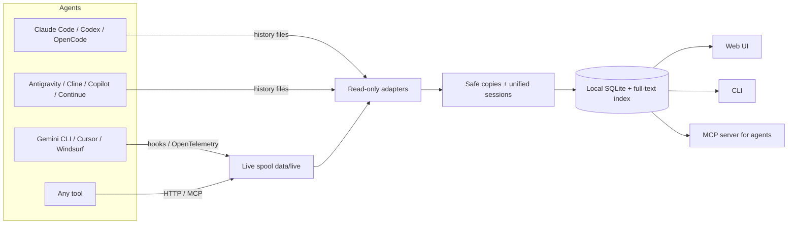

1. **Adapters** read each agent's own history (a byte-for-byte safe copy is made first; the original is never opened for writing).
2. **Live capture** handles agents whose history is unreadable: a tiny hook recorder, an OpenTelemetry receiver and an MCP tool append raw events to `data/live/`, which is imported like any other source.
3. Everything becomes the same **unified session model**: prompts, answers, tool calls and results, file edits, commands, errors, models, token usage and how the session ended.
4. The **web UI, CLI and MCP server** all read from that one local database.

Details: [docs/ARCHITECTURE.md](docs/ARCHITECTURE.md).

## What you can do

| You want to | Go to |
| --- | --- |
| See what every agent did this week | **Overview**: activity per agent, latest sessions, what needs attention |
| Connect more agents | **Connected agents** |
| Browse or filter sessions by agent, project, outcome, date | **Sessions** |
| Find anything an agent said or ran | **Search** (or the search box on every page) |
| Hand a project or session to another agent | **Handoff Center**, or *Continue* on any session/project |
| Ask questions about your history (optional AI) | **Ask my projects** |
| Find unfinished work hidden in Git worktrees | **Worktrees** |
| Check what agents claimed was done | **Verify & Triage** |
| Keep one rules file for every agent | Project → *Agent rules* (writes CLAUDE.md, AGENTS.md, Cursor rules, GEMINI.md) |
| Track spending and usage limits | **Costs & Limits** |
| See your month or year with AI agents, and share it | **AI Coding Wrapped** (download a 1200×630 image, drawn in your browser) |
| Compare agents: finish, interruption and error rates, tools per prompt, files per session, cost per finished session | **Connected agents → Compare agents** |
| Find the best skills and MCP servers for each agent, and how to install and use them | **Skills Shop** |
| Back up everything (optionally encrypted to the cloud) | **Backups** |

The UI is available in English and Arabic (right-to-left) and works on phones.

<table>
  <tr>
    <td width="50%">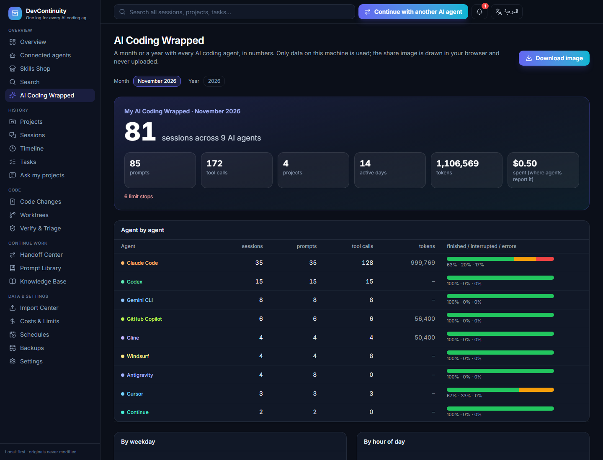<br /><sub><b>AI Coding Wrapped:</b> sessions, prompts, tool calls, tokens and outcomes per agent, with a shareable image.</sub></td>
    <td width="50%">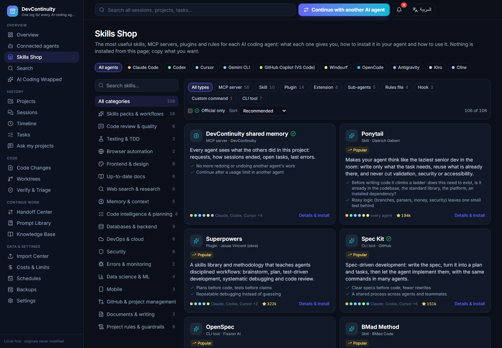<br /><sub><b>Skills Shop:</b> 100+ verified skills, MCP servers, plugins and rules (Ponytail, Superpowers, Spec Kit, official MCP servers…) in 18 categories, filtered by agent and type, with install steps for each of ten agents.</sub></td>
  </tr>
  <tr>
    <td colspan="2">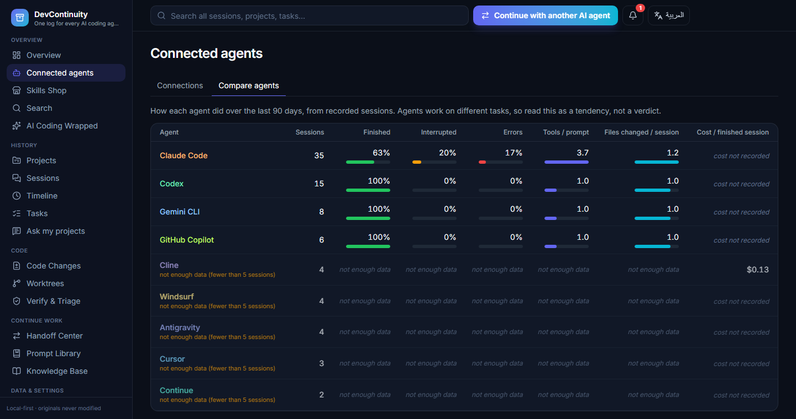<br /><sub><b>Compare agents:</b> honest "not enough data" instead of ranking small samples.</sub></td>
  </tr>
</table>

## CLI

With npx (or `devcontinuity` after `npm i -g devcontinuity`; from a checkout, `npm run dc --`):

```bash
npx devcontinuity agents                          # what is connected and what it has logged
npx devcontinuity connect windsurf                # preview the change; add --yes to apply
npx devcontinuity import --agent antigravity      # import one agent now
npx devcontinuity sessions --limit 20
npx devcontinuity search "payment webhook"
npx devcontinuity resume --project my-app --agent codex     # print a continuation briefing
npx devcontinuity handoff --project my-app --drop-in        # full handoff package + RESUME.md in the repo
npx devcontinuity wrapped --month 2026-11                   # AI Coding Wrapped in the terminal (--year 2026, --json)
npx devcontinuity backup
```

## MCP server (let agents use it)

`connect` registers DevContinuity's MCP server with the agent. The agent then gets:

- `project_context`: shared memory (below). `recent_activity` is its short form.
- `get_resume_briefing`, `search_history`, `list_sessions`, `list_tasks`.
- `log_summary` / `log_event`: write into the shared log ("what I did, what is left").

To register it by hand: command `npx`, arguments `-y devcontinuity mcp` (or, from a checkout, `node <repo>/node_modules/tsx/dist/cli.mjs <repo>/scripts/mcp.ts`).

### Your agents finally share memory

Every agent starts each task blind to what the others did. With DevContinuity connected, one call fixes that:

```text
project_context { directory: "/work/acme-shop-api" }

# Shared memory: acme-shop-api
## What each agent did
### Claude Code (9 sessions)
- 2026-11-18 19:31 · error · Add rate limiting to the public checkout endpoints
  stopped because: You've hit your session limit · resets 5pm
### Codex (3 sessions)
- 2026-11-18 19:56 · finished · Rate limiting for checkout
## Summaries agents logged (log_summary)
## Open tasks
## Last errors
## Files changed recently
```

It lists, per agent, what was asked, how each session ended and the last answer, plus the summaries agents logged, open tasks, the last errors and recently changed files, in a few kilobytes. In **Projects → (project) → Rules**, tick *Shared memory* when you sync the rules: DevContinuity adds a short instruction to `CLAUDE.md`, `AGENTS.md`, `GEMINI.md` and Cursor's rules telling every agent to call `project_context` when it starts and `log_summary` when it finishes.

## Any other tool

Anything that can make an HTTP request can log into DevContinuity. Send the local token from `data/.api-token` as a Bearer token:

```bash
curl -X POST http://localhost:3210/api/ingest/event \
  -H "Authorization: Bearer $(cat data/.api-token)" \
  -H "Content-Type: application/json" \
  -d '{"agent":"my-tool","session":"s1","cwd":"/path/to/project","events":[
        {"kind":"prompt","text":"add tests"},
        {"kind":"tool_result","tool":"edit","file":"/path/to/project/test.py"},
        {"kind":"assistant","text":"Added 3 tests."}]}'
```

Event kinds: `prompt`, `assistant`, `thinking`, `tool_call`, `tool_result`, `error`, `usage`, `summary`. OpenTelemetry exporters can post **JSON** logs to `/api/otlp/v1/logs`.

## Configuration

Everything works without configuration. Optional settings go in `.env.local` (see [.env.example](.env.example)):

| Variable | Purpose |
| --- | --- |
| `DEVCONTINUITY_DATA_DIR` | Where the database, safe copies, live captures and backups live (default `~/.devcontinuity` for `npx`/npm installs, `./data` in a checkout) |
| `PORT` | Web UI port (default 3210; or `npx devcontinuity --port 4000`) |
| `DEVCONTINUITY_DEMO=1` | Read-only public demo mode: every write is refused and a Demo ribbon is shown. See [docs/DEMO.md](docs/DEMO.md) |
| `ANTHROPIC_API_KEY` | Optional AI features (summaries, *Ask my projects*). Other providers (OpenAI, Gemini, OpenRouter, DeepSeek, Ollama, LM Studio) are added in **Settings** |
| `CLAUDE_CONFIG_DIR`, `CODEX_HOME`, `CONTINUE_GLOBAL_DIR` | Non-default agent locations. More folders can be added in **Settings → Agents** |

## Privacy and security

- Runs locally and only answers requests from `localhost`; every API call needs a local token, and cross-origin requests are rejected.
- Agent originals are read once into safe copies and never modified, moved or deleted. Credential files are never read.
- Secrets are redacted before anything is stored, exported, handed off or sent to an AI provider.
- No telemetry. Nothing leaves your machine unless you turn on an AI provider or a cloud backup.

Found a security problem? See [SECURITY.md](SECURITY.md).

## Optional: AI organization (experimental)

An experimental module where a "CEO" agent plans your requests and AI workers carry them out in sandbox Git worktrees, with your approval at every step. It is off by default; turn it on in **Settings → Features**. It lives in its own module ([src/modules/org](src/modules/org/README.md)); while it is off its pages and API answer 404, and its data is kept.

## Hosted demo

`DEVCONTINUITY_DEMO=1` serves the fictional demo workspace read-only, and the [Dockerfile](Dockerfile) packages it. See [docs/DEMO.md](docs/DEMO.md).

## Contributing

Contributions are welcome, especially adapters for more agents. See [CONTRIBUTING.md](CONTRIBUTING.md), the [roadmap](docs/ROADMAP.md) (with good first issues) and the [code of conduct](CODE_OF_CONDUCT.md).

## Releasing (maintainers)

```bash
npm run build && npm run pack:check     # packs, scans for private paths, installs and starts the tarball
git tag v2.1.0 && git push origin v2.1.0 # CI checks everything and creates the GitHub release with the tarball
npm publish devcontinuity-2.1.0.tgz      # the tarball attached to the release (built on Linux)
```

Release notes come from [CHANGELOG.md](CHANGELOG.md).

## License

[MIT](LICENSE) © 2026 Ahmad Albarghash
