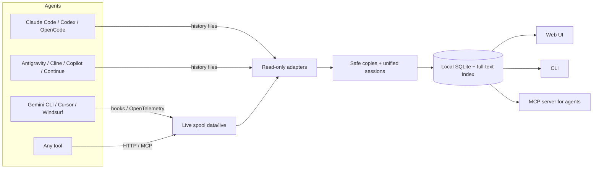

# DevContinuity

**One local log for every AI coding agent.**

You use Claude Code in the morning, Codex after lunch, Antigravity or Cursor for a UI task, and Copilot in VS Code. Each one keeps its history in its own place and format, and none of them knows what the others did. DevContinuity collects all of it into one searchable timeline on your own machine, shows what each agent actually changed, and lets any agent pick up where another one stopped.

- **Every agent, one timeline:** Claude Code, Codex, OpenCode, Antigravity, Cline, Roo Code, Kilo Code, GitHub Copilot Chat, Continue, Gemini CLI, Cursor, Windsurf, and anything that can send an HTTP request.
- **Local-first:** runs on your computer and keeps your data in one folder. Your agents' original files are only ever read, never modified.
- **Continue anywhere:** a ready-to-paste briefing (last request, last answer, changed files, errors, Git state) lets another agent take over a project or session.
- **Trust, but verify:** agent "I'm done" claims are tracked as claims; DevContinuity checks recorded edits and commits against your actual files and Git.
- **Search everything:** full-text search over every prompt, answer, tool call, command and error, in any language.

> Status: works well day to day on Windows; macOS and Linux run the same web app and background service (the tray icon is Windows-only). See [docs/ARCHITECTURE.md](docs/ARCHITECTURE.md#limitations) for what is and is not covered per agent.

---

## Quick start

You need **Node.js 22.5 or newer** and **Git**.

```bash
git clone https://github.com/ahmadrashed1999/devcontinuity.git
cd devcontinuity
npm install
npm run setup     # creates ./data and the database (safe to repeat; never deletes anything)
npm run build
npm run app       # web UI + background sync at http://localhost:3210
```

Open **http://localhost:3210**. The first sync imports every agent it finds on your machine; after that, new sessions appear on their own.

On Windows you can instead run `npm run tray` for a tray icon, and `npm run startup:install` to start it with Windows.

New here? Read the **[usage guide](docs/USAGE.md)**: it walks through the first import, connecting agents, finding things and continuing work.

---

## Supported agents

| Agent | How it is captured | Setup |
| --- | --- | --- |
| Claude Code | Transcript files (`~/.claude/projects`), including sub-agents | Automatic |
| OpenAI Codex CLI | Rollout files (`~/.codex/sessions`), including compressed ones | Automatic |
| OpenCode | Its SQLite database | Automatic |
| Google Antigravity | Its conversation index: titles, folders, sub-agents, every message in order, plans | Automatic |
| Cline, Roo Code, Kilo Code | Task files in VS Code, Cursor, Windsurf, Antigravity, Trae… | Automatic |
| GitHub Copilot Chat | VS Code chat sessions, in every VS Code-family editor | Automatic |
| Continue | `~/.continue/sessions` | Automatic |
| Gemini CLI | Hooks (+ optional OpenTelemetry for token usage) | `npm run dc -- connect gemini-cli --yes` |
| Cursor | Hooks | `npm run dc -- connect cursor --yes` |
| Windsurf | Hooks (its own history is encrypted) | `npm run dc -- connect windsurf --yes` |
| Anything else | HTTP API, OpenTelemetry logs, or the MCP `log_summary` tool | See [Any other tool](#any-other-tool) |

"Connect" is also one click on the **Connected agents** page. It shows exactly which config files it will change, backs up the originals first, and only adds or removes DevContinuity's own entries. `npm run dc -- disconnect <agent> --yes` undoes it.

## How it works



1. **Adapters** read each agent's own history (a byte-for-byte safe copy is made first; the original is never opened for writing).
2. **Live capture** handles agents whose history is unreadable: a tiny hook recorder, an OpenTelemetry receiver and an MCP tool append raw events to `data/live/`, which is imported like any other source.
3. Everything becomes the same **unified session model**: prompts, answers, tool calls and results, file edits, commands, errors, models, token usage and how the session ended.
4. The **web UI, CLI and MCP server** all read from that one local database.

Details: [docs/ARCHITECTURE.md](docs/ARCHITECTURE.md).

## What you can do

| You want to | Go to |
| --- | --- |
| See what every agent did this week | **Overview**: activity per agent, latest sessions, what needs attention |
| Connect more agents | **Connected agents** |
| Browse or filter sessions by agent, project, outcome, date | **Sessions** |
| Find anything an agent said or ran | **Search** (or the search box on every page) |
| Hand a project or session to another agent | **Handoff Center**, or *Continue* on any session/project |
| Ask questions about your history (optional AI) | **Ask my projects** |
| Find unfinished work hidden in Git worktrees | **Worktrees** |
| Check what agents claimed was done | **Verify & Triage** |
| Keep one rules file for every agent | Project → *Agent rules* (writes CLAUDE.md, AGENTS.md, Cursor rules, GEMINI.md) |
| Track spending and usage limits | **Costs & Limits** |
| Back up everything (optionally encrypted to the cloud) | **Backups** |

The UI is available in English and Arabic (right-to-left) and works on phones.

## CLI

```bash
npm run dc -- agents                          # what is connected and what it has logged
npm run dc -- connect windsurf                # preview the change; add --yes to apply
npm run dc -- import --agent antigravity      # import one agent now
npm run dc -- sessions --limit 20
npm run dc -- search "payment webhook"
npm run dc -- resume --project my-app --agent codex     # print a continuation briefing
npm run dc -- handoff --project my-app --drop-in        # full handoff package + RESUME.md in the repo
npm run dc -- backup
```

## MCP server (let agents use it)

`connect` registers DevContinuity's MCP server with the agent. The agent then gets:

- `recent_activity`: what every agent did recently in this folder (call it before starting work).
- `get_resume_briefing`, `search_history`, `list_sessions`, `list_tasks`.
- `log_summary` / `log_event`: write into the shared log ("what I did, what is left").

To register it by hand: command `node`, arguments `<repo>/node_modules/tsx/dist/cli.mjs <repo>/scripts/mcp.ts`.

## Any other tool

Anything that can make an HTTP request can log into DevContinuity. Send the local token from `data/.api-token` as a Bearer token:

```bash
curl -X POST http://localhost:3210/api/ingest/event \
  -H "Authorization: Bearer $(cat data/.api-token)" \
  -H "Content-Type: application/json" \
  -d '{"agent":"my-tool","session":"s1","cwd":"/path/to/project","events":[
        {"kind":"prompt","text":"add tests"},
        {"kind":"tool_result","tool":"edit","file":"/path/to/project/test.py"},
        {"kind":"assistant","text":"Added 3 tests."}]}'
```

Event kinds: `prompt`, `assistant`, `thinking`, `tool_call`, `tool_result`, `error`, `usage`, `summary`. OpenTelemetry exporters can post **JSON** logs to `/api/otlp/v1/logs`.

## Configuration

Everything works without configuration. Optional settings go in `.env.local` (see [.env.example](.env.example)):

| Variable | Purpose |
| --- | --- |
| `DEVCONTINUITY_DATA_DIR` | Where the database, safe copies, live captures and backups live (default `./data`) |
| `PORT` | Web UI port for `npm run app` (default 3210) |
| `ANTHROPIC_API_KEY` | Optional AI features (summaries, *Ask my projects*). Other providers (OpenAI, Gemini, OpenRouter, DeepSeek, Ollama, LM Studio) are added in **Settings** |
| `CLAUDE_CONFIG_DIR`, `CODEX_HOME`, `CONTINUE_GLOBAL_DIR` | Non-default agent locations. More folders can be added in **Settings → Agents** |

## Privacy and security

- Runs locally and only answers requests from `localhost`; every API call needs a local token, and cross-origin requests are rejected.
- Agent originals are read once into safe copies and never modified, moved or deleted. Credential files are never read.
- Secrets are redacted before anything is stored, exported, handed off or sent to an AI provider.
- No telemetry. Nothing leaves your machine unless you turn on an AI provider or a cloud backup.

Found a security problem? See [SECURITY.md](SECURITY.md).

## Optional: AI organization (experimental)

An experimental module where a "CEO" agent plans your requests and AI workers carry them out in sandbox Git worktrees, with your approval at every step. It is off by default; turn it on in **Settings → Features**.

## Contributing

Contributions are welcome, especially adapters for more agents. See [CONTRIBUTING.md](CONTRIBUTING.md).

## License

[MIT](LICENSE) © 2026 Ahmad Albarghash
